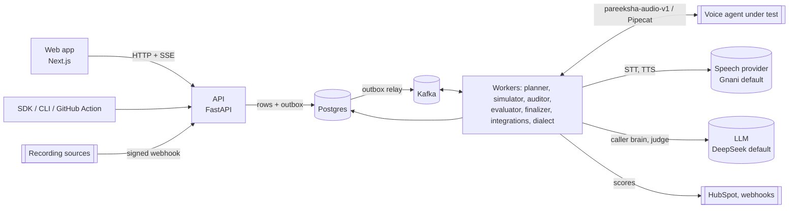

# Pareeksha

Crash-test voice AI agents the way India actually talks.

Pareeksha calls your voice bot with synthetic Indian callers (Kannada, Hindi, Hinglish and Kanglish, on clean or noisy phone lines), records every call, and scores it with deterministic checks plus an LLM judge that cites the exact turn behind each score. The same judge audits real recordings after launch, a dialect report shows where speech recognition breaks, and results flow to HubSpot, webhooks and CI.

Speech runs on Gnani by default: Prisma for speech to text and Timbre for text to speech. The caller and the judge run on DeepSeek by default.

Release `v1.0.0` is tagged. Read [Limitations](#limitations) before relying on a score: the judge does not yet agree well with human labels.

## What you can do

| In the web app | What it does |
|---|---|
| **Voice agents** | Connect a bot over `pareeksha-audio-v1` (WebSocket) or Pipecat, and check the connection. |
| **Personas**, **Noise profiles**, **Scenarios** | Choose who calls (20 seeded Indian personas), on which line (8 profiles, from clean 16 kHz to 8 kHz phone audio with office, street, market, bus or auto-rickshaw noise and a weak mobile signal), and what they want. |
| **Test designer** | Build a test in a chat instead of filling in forms. |
| **New run**, **Results**, **Run compare** | Run scenario × persona × noise combinations, then open any call: recording, waveform, synced transcript, scores and the evidence turns. Compare two runs to see what a fix changed. |
| **Regression** | Promote a failed call to a permanent regression test with one click. |
| **Audits** | Upload a real recording (or send it by signed webhook) and score it with the same judge. |
| **Dialect** | Run labelled clips through speech recognition under clean, phone and noisy conditions, and see error rates per group with sample sizes. |
| **Test my prompt** | Test a prompt with typed conversations before there is a voice bot, and see what a prompt change fixed or broke. |
| **Documents**, **RAG lab** | Upload documents, generate questions with known answers, and compare retrieval setups on hit rate, hallucinations, latency and cost. |
| **Integrations**, **DLQ**, **Calibration** | Send scores to HubSpot or a webhook, replay failed events, and measure the judge against human labels. |

The same operations are available from the Python SDK and CLI (`pareeksha run`, `regress`, `audit`, `apply`, `doctor`) and from a GitHub Action that fails a pull request when a regression suite fails.

A bundled mock agent (an EMI reminder bot) has five bugs you can switch on with `MOCK_BUGS` (`no_disclosure`, `no_amount_confirm`, `english_to_kannada`, `ignore_interrupt`, `false_waiver`) to watch the judge catch them.

## Quick start

You need Docker with Compose v2, Python 3.11+, OpenSSL, a Gnani API key and a DeepSeek API key. Full walkthrough: [Guide 1](docs/guides/01-quickstart.md).

```bash
git clone https://github.com/voice-application/pareeksha- pareeksha && cd pareeksha
cp .env.example .env        # set GNANI_API_KEY and DEEPSEEK_API_KEY
make demo                   # generates the other secrets, starts the stack, seeds it, runs a 10-call demo
```

`make demo` fills in `SECRET_KEY`, `PAREEKSHA_API_KEY` and `SESSION_SECRET` in `.env` when they are empty. It never overwrites a value you set.

Open <http://localhost:3000>. The first visit to `/login` creates the admin account.

To run one call from the CLI instead:

```bash
python3 -m venv .venv && . .venv/bin/activate
pip install ./sdk/python
set -a; . ./.env; set +a
pareeksha login --url http://localhost:8000 --key "$PAREEKSHA_API_KEY"
pareeksha run --agent "EMI Reminder Bot" --tags promise_to_pay \
  --persona "Manju — auto driver" --noise clean_16k --wait
```

One call takes about two minutes, because Gnani allows one active request per key.

## Configuration

Every setting is in [`.env.example`](.env.example). The ones you are most likely to change:

| Setting | Default | Notes |
|---|---|---|
| `GNANI_API_KEY`, `DEEPSEEK_API_KEY` | none | Required. |
| `SESSION_SECRET` | none | Required for sign-in, 16+ characters. `make demo` generates it. The web app refuses the old public default. |
| `LLM_PROVIDER` | `deepseek` | `gemini` is the alternative. |
| `STT_PROVIDER`, `TTS_PROVIDER` | `gnani` | Also `google`, `azure`, `elevenlabs`, `deepgram` (see Limitations). |
| `BIND_HOST` | `127.0.0.1` | Published ports listen on localhost only. Set `0.0.0.0` to expose them, only behind a firewall or reverse proxy, and change `POSTGRES_PASSWORD` first. |
| `AGENT_ALLOW_PRIVATE_ENDPOINTS` | `true` | Lets agents live on `localhost` or the bundled mock agent. Set `false` when hosting Pareeksha for others. Cloud metadata addresses are always refused. |
| `RUN_ITEM_STALE_AFTER_S` | `15060` | A call with no progress for this long is ended as an infrastructure error and its slot released. |
| `SIMULATOR_REPLICAS` | `3` | Use `1` with a single Gnani key. |

Recordings, the speech cache and downloaded models live in the `runtime-data` Docker volume. Containers run as a non-root user.

**Upgrading from a version that used `./data/runtime`:** start the stack once, then copy the old data in and hand it to the container user:

```bash
docker compose cp ./data/runtime/. api:/data/ && docker compose exec --user root api chown -R app:app /data
```

**Roles:** admins manage users, API keys, AI settings, integrations and dead-letter replay. Members can read everything and start runs, audits and tests.

## Architecture



Postgres is the system of record. Events go through a transactional outbox to Kafka. Consumers are idempotent, with retry topics and a dead-letter queue. A reconciler ends calls that failed for good and releases their concurrency slots. Details: [docs/04-system-design.md](docs/04-system-design.md).

## Repository layout

| Path | Contents |
|---|---|
| `backend/` | FastAPI API, workers, evaluation and judge, Alembic migrations, tests |
| `web/` | Next.js app and Playwright tests |
| `sdk/python/` | `pareeksha-sdk` client and CLI |
| `action/` | GitHub Action |
| `mock_agent/` | Mock EMI reminder bot with planted bugs |
| `examples/` | Pipecat bot, CI config, example connector |
| `docs/` | Specification, design notes and guides |
| `proof/` | Evidence from the acceptance runs (logs, reports, recordings) |

## Development

```bash
make lint      # ruff, ruff format --check, mypy (strict), eslint, tsc
make test      # backend unit, evaluation, judge and contract tests
make verify    # acceptance checks V1 to V11; needs live keys, writes proof/FINAL_REPORT.md
```

CI runs lint, types, the backend and SDK tests, the Postgres migration and end-to-end tests, the Kafka suite, and the web Playwright suite on every pull request.

## Guides

| # | Guide |
|---|---|
| 1 | [Quick start](docs/guides/01-quickstart.md) |
| 2 | [Connect your Pipecat bot](docs/guides/02-connect-pipecat.md) |
| 3 | [Connect any bot with `pareeksha-audio-v1`](docs/guides/03-connect-any-bot.md) |
| 4 | [Send recordings in with the webhook source](docs/guides/04-webhook-source.md) |
| 5 | [Send scores to HubSpot](docs/guides/05-hubspot.md) |
| 6 | [Run tests on every PR with the GitHub Action](docs/guides/06-github-action.md) |
| 7 | [Write your own connector](docs/guides/07-write-a-connector.md) |
| 8 | [Operating Kafka: topics, lag, DLQ replay](docs/guides/08-operating-kafka.md) |
| 9 | [Test a prompt before you ship it](docs/guides/09-prompt-testing.md) |
| 10 | [Test retrieval (RAG) before you ship it](docs/guides/10-rag-testing.md) |
| - | [SDK and CLI reference](docs/guides/sdk-reference.md) |

## Limitations

- **The judge disagrees with human labels too often.** Cohen's kappa against the owner's pass/fail labels on 30 calls is 0.19 (95% CI -0.14 to 0.52), against a 0.6 target, measured with `rubric-2026-10-v1` ([calibration report](proof/EVAL-06/calibration.md)). It most often passes calls where the agent dodged the caller's question. Treat a single score as a signal and read the cited evidence.
- **Calls are slow.** Gnani allows one active request per key, so simulated calls run in real time and one after another; a 12-call run takes tens of minutes.
- **Speech providers.** Gnani is the only provider used in full evaluated runs. ElevenLabs and Deepgram passed a live smoke test only. Google and Azure have not been run against the live services.
- **Not built.** LiveKit and Vapi adapters, and Salesforce, Zoho, LeadSquared, Freshdesk, Exotel and Slack connectors ([Guide 7](docs/guides/07-write-a-connector.md) shows how to add one).
- **HubSpot.** Live acceptance used synthetic contacts and a recording made from two TTS voices, not a real call. The check with a consented real recording is still pending.
- **Dialect report.** Results come from 110 Vaani clips (CC-BY-4.0): 5 groups of 22, 3 audio conditions, Gnani Prisma only ([report](proof/DIALECT-02/report.html)). The sample is small, Kannada word error rates are inflated by colloquial spellings (compare groups and prefer character error rate), and accents were not confirmed by listening.
- **Single node.** Compose runs one Kafka broker and one Postgres. It suits a team, not a high-availability deployment.
- **Login lockout.** Five wrong passwords lock an account for a few minutes, so someone who knows an email address can lock it out briefly.

Open acceptance items are tracked in [STATUS.md](STATUS.md) and [proof/FINAL_REPORT.md](proof/FINAL_REPORT.md).

## Contributing

Contract changes are logged in [CHANGELOG.md](CHANGELOG.md). The multi-agent build rules used to create the project are in [docs/AGENTS.md](docs/AGENTS.md).

## Safety

Keep secrets in `.env`, which is never committed (see `.env.example`). Test fixtures are synthetic. Voice and dialect clips require the speaker's consent.
