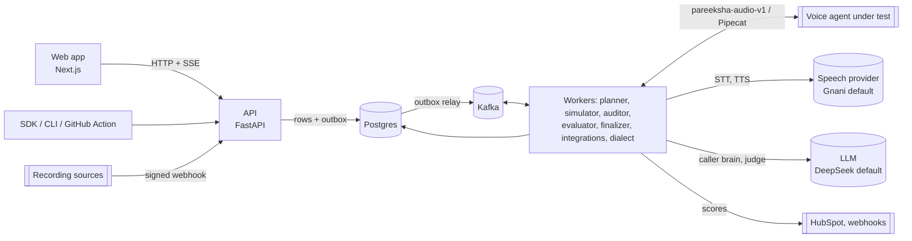

# Pareeksha

India-native crash-testing and call-audit platform for voice AI agents. Synthetic Indian callers (Kannada, Hindi, Hinglish/Kanglish, noisy phone lines) test a voice bot before launch; the same judge audits real calls after launch; a dialect report shows where speech recognition breaks; results flow to HubSpot, webhooks and CI.

Status: build in progress (spec v0.2). Live task board: [STATUS.md](STATUS.md). Full spec: [docs/README.md](docs/README.md).

## Quick start
Target: first evaluated call in under 20 minutes. Needs Docker (Compose v2), Python 3.11+, a Gnani key and a DeepSeek key. Full walkthrough: [Guide 1](docs/guides/01-quickstart.md).

```bash
git clone https://github.com/voice-application/pareeksha- pareeksha && cd pareeksha
cp .env.example .env     # set GNANI_API_KEY, DEEPSEEK_API_KEY, SIMULATOR_REPLICAS=1; append SECRET_KEY and PAREEKSHA_API_KEY (see the guide)
docker compose --profile workers up -d --build
docker compose run --rm api python -m pareeksha.seed      # personas, noise profiles, rubric, mock EMI agent, API key
pip install ./sdk/python
pareeksha login --url http://localhost:8000 --key "$PAREEKSHA_API_KEY"
pareeksha run --agent "EMI Reminder Bot" --tags promise_to_pay --persona "Manju — auto driver" --noise clean_16k --wait
```
Then open <http://localhost:3000> for the call: transcript, waveform, judge scores with evidence.

Providers: LLM is DeepSeek by default (`LLM_PROVIDER=gemini` for Gemini); speech is Gnani by default (`STT_PROVIDER` / `TTS_PROVIDER` may be `google`, `azure`, `elevenlabs` or `deepgram`; those four are implemented but not yet verified against the live services).

## Architecture

Details: [docs/04-system-design.md](docs/04-system-design.md).

## Guides
| # | Guide |
|---|---|
| 1 | [Quick start](docs/guides/01-quickstart.md) |
| 2 | [Connect your Pipecat bot](docs/guides/02-connect-pipecat.md) |
| 3 | [Connect any bot with `pareeksha-audio-v1`](docs/guides/03-connect-any-bot.md) |
| 4 | [Send recordings in with the webhook source](docs/guides/04-webhook-source.md) |
| 5 | [Send scores to HubSpot](docs/guides/05-hubspot.md) |
| 6 | [Run tests on every PR with the GitHub Action](docs/guides/06-github-action.md) |
| 7 | [Write your own connector](docs/guides/07-write-a-connector.md) |
| 8 | [Operating Kafka: topics, lag, DLQ replay](docs/guides/08-operating-kafka.md) |
| - | [SDK and CLI reference](docs/guides/sdk-reference.md) |

## Limitations
- Gnani allows one active request per key, so simulated calls are real time and effectively serial per key; a 12-call run takes tens of minutes.
- Only Gnani is verified live among speech providers; Google, Azure, ElevenLabs and Deepgram adapters await keys. LiveKit and Vapi adapters are not built; Salesforce, Zoho, LeadSquared, Freshdesk, Exotel and Slack connectors are designed for, not built (Guide 7 shows how).
- The HubSpot sink is tested against mocked HubSpot APIs; a live portal test needs an owner-provided token.
- Dialect results need consented clips (H-02); the dialect heatmap in `proof/EVAL-05/report.html` comes from a small synthetic set and says nothing about real dialect error rates.
- The judge is an LLM: scores are calibrated against labelled calls, not ground truth. Treat a single score as a signal and read the evidence.
- Single-node Kafka and Postgres in Compose: fine for a team, not an HA deployment. Behind a TLS-intercepting proxy use `docker-compose.proxy.yml`.

## Contributing and agents
Multi-agent build rules: [docs/AGENTS.md](docs/AGENTS.md). Contract changes are logged in [CHANGELOG.md](CHANGELOG.md).

## Safety
Secrets only in `.env` (never committed; see `.env.example`). Fixtures are synthetic; voice and dialect clips require consent.
