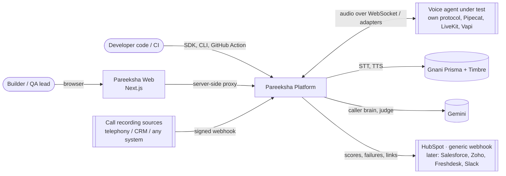
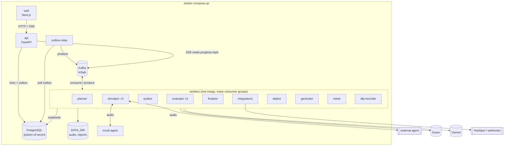
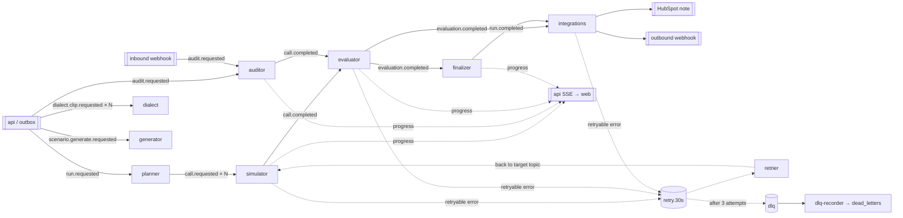
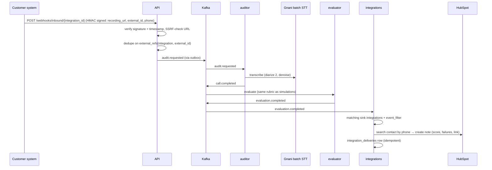
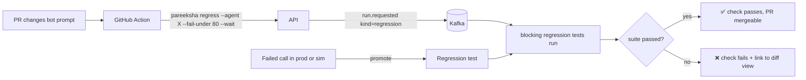

# 04 — System Design · v0.2

Diagrams use Mermaid (GitHub, VS Code, most Markdown viewers render them).

**v0.2:** Kafka event backbone, Next.js web app, connectors (HubSpot, webhook), SDK/CLI/GitHub Action.

---

## 1. System context



## 2. Containers



**Why this shape**
- **Postgres owns state, Kafka moves work.** Every fact (run, call, score) lives in Postgres; Kafka carries "this happened, do the next step" events. This keeps queries easy and lets Kafka be replaced or scaled without migrating data.
- **The API never does slow work and never publishes directly.** It writes rows and outbox events in one transaction; the relay publishes. Kafka outages don't break the API.
- **Each pipeline stage is a consumer group.** Scale a stage by adding instances, up to its partition count. Stages fail and retry independently.
- **The web app only talks to the API**, through its own server-side proxy, so keys never reach the browser and the API is the single contract for the web app, SDK and CLI.

## 3. Event flow



## 4. Key flows

### 4.1 Crash-test run

```mermaid
sequenceDiagram
    actor U as User
    participant W as Web
    participant A as API
    participant DB as Postgres
    participant K as Kafka
    participant P as planner
    participant S as simulator
    participant AG as Agent under test
    participant E as evaluator
    participant F as finalizer

    U->>W: New run (agent, scenarios, personas, profiles)
    W->>A: POST /runs (via proxy)
    A->>DB: BEGIN; insert run; insert outbox(run.requested); COMMIT
    A-->>W: 201 {run_id, estimate}
    W->>A: GET /runs/{id}/events (SSE)
    Note over DB,K: outbox-relay publishes run.requested
    K->>P: run.requested
    P->>DB: insert run_items (matrix, seeds)
    P->>K: call.requested × N (key = run_item_id)
    K->>S: call.requested
    S->>DB: take run slot (active_calls < max)
    S->>AG: connect via adapter, simulate call (Gnani STT/TTS, Gemini caller, line simulator)
    S->>DB: save call, turns, recordings; release slot; processed_events
    S->>K: call.completed, progress
    K->>E: call.completed
    E->>E: metrics, checks, PII mask, Gemini judge, scoring in code
    E->>DB: save evaluation; processed_events
    E->>K: evaluation.completed, progress
    K->>F: evaluation.completed
    F->>DB: update run summary
    F->>K: run.completed (when last item done)
    K-->>A: progress events
    A-->>W: SSE item.status / call.evaluated / run.completed
```

### 4.2 Imported call → audit → CRM



### 4.3 Failure handling

```mermaid
sequenceDiagram
    participant K as Kafka
    participant C as any consumer
    participant R as retrier
    participant D as dlq-recorder
    K->>C: message (attempt 1)
    C--xC: retryable error (e.g. Gnani 503)
    C->>K: copy → retry.30s (attempt 2, not_before = now+30s); commit offset
    K->>R: retry.30s message
    R->>R: wait until not_before
    R->>K: re-produce to original topic
    K->>C: message (attempt 2)
    C--xC: fails again
    C->>K: copy → retry.5m (attempt 3)
    K->>C: message (attempt 3)
    C--xC: fails again
    C->>K: copy → dlq (x-error)
    K->>D: dlq message
    D->>D: insert dead_letters (status open)
    Note over D: Web DLQ page / `pareeksha dlq replay` re-publishes with attempt 1
```

### 4.4 Regression loop (CI)



## 5. State machines

Run item: `queued → connecting → in_progress → completed → evaluating → evaluated` (side exits: `error`, `judge_error`, `cancelled`, `skipped_budget`).
Run: `queued → running → completed | partial | cancelled | failed`.
Outbox row: `unpublished → published`.
Dead letter: `open → replayed | discarded`.
Integration delivery: `pending → succeeded | failed | skipped`.

## 6. Data & storage

| Data | Where | Retention |
|---|---|---|
| Config, runs, calls, turns, scores, integrations | Postgres | permanent |
| Events | Kafka | 7 days (progress 1 day) |
| Outbox rows | Postgres | published rows pruned after 3 days |
| `processed_events` | Postgres | pruned after 14 days (> Kafka retention) |
| Audio, raw STT JSON | `DATA_DIR` behind `BlobStore` | `AUDIO_RETENTION_DAYS` (30) |
| Reports | `DATA_DIR/reports` | permanent |

## 7. Scaling path

| Pressure | v1 (one machine) | Later |
|---|---|---|
| More simulated calls | 3 simulator instances, 6 partitions | More instances + partitions; workers on several machines; per-agent rate limits |
| Kafka | 1 broker, RF 1 | 3 brokers / managed Kafka, RF 3 |
| Real phone path | WebSocket adapters | LiveKit SIP / Exotel trunk adapter (same `call.requested` event) |
| Live production monitoring | Webhook import after call ends | Streaming audio topic per live call; real-time alerts consumer |
| Storage | Local disk | S3/MinIO, signed URLs |
| Multi-tenant | Single project, API keys | Auth, org/workspace, `project_id` already on every table |
| Event contracts | Pydantic + version field | Schema registry (Avro/Protobuf) |

## 8. Design trade-offs

| Decision | Chosen | Alternative | Reason |
|---|---|---|---|
| Work distribution | Kafka event log | Postgres queue (v0.1) | Independent scaling per stage, replay, natural fit for future streaming; accepted cost: retry/DLQ must be built (§TRD 10.5) |
| API → Kafka | Transactional outbox | Publish directly from request | No lost or phantom events when Kafka or the DB hiccups |
| Exactly-once | At-least-once + idempotent consumers | Kafka transactions | Kafka EOS doesn't cover Postgres or HTTP side effects |
| `call.requested` key | run_item_id | run_id | Lets one run use many simulators at once |
| Delays | Fixed-delay retry topics | Broker-side delays (not in Kafka) | Kafka has no per-message delay |
| Web | Next.js + BFF proxy | Streamlit (v0.1), SPA calling API directly | Production-quality UI; keys stay server-side |
| Live updates | SSE | WebSockets | One-way, simpler, works through the proxy |
| Integrations | Plugin connectors via entry points | Hard-coded CRM calls | Others add CRMs without forking |
| Overall score | Computed in code | LLM output | LLM arithmetic is unreliable |
| Dialect evidence | Real recordings | Synthetic accents | Synthetic voices can't stand in for dialects |
