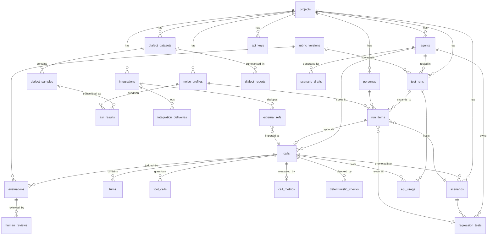

# 05 — Database Design · v0.2

PostgreSQL 16 is the **system of record**; Kafka only moves work between stages. The runnable DDL is [`schema.sql`](schema.sql) (tested: applies cleanly to a fresh Postgres 16 database, 29 tables; the outbox claim, idempotency insert and per-run slot queries were also run).

**v0.2 changes:** removed `jobs` (Kafka replaces it); added `outbox_events`, `processed_events`, `dead_letters`, `integrations`, `integration_deliveries`, `external_refs`, `api_keys`, `scenario_drafts`; `agents.connection_type` → `agents.adapter` (+ adapter config/secrets); `calls.source` gains `import` and `calls.metadata`; `test_runs.active_calls`.

---

## 1. Entity-relationship diagram



`outbox_events`, `processed_events` and `dead_letters` are Kafka plumbing and reference entities only through their JSON envelopes.

---

## 2. Table groups

### 2.1 Configuration — *what to test*

| Table | Purpose | Key columns |
|---|---|---|
| `projects` | Tenant boundary. One row in v1. Exists so multi-user later doesn't need a migration of every table. | `name` |
| `agents` | The voice bot under test. Holds everything needed to call it and to judge it. | `adapter` (audio_v1/pipecat/livekit/vapi), `endpoint_url`, `adapter_config`, `adapter_secrets_encrypted`, `languages[]`, `glass_box`, `mandatory_disclosures` (JSONB), `forbidden_phrases`, `expected_tools`, `bias_list[]` |
| `scenario_drafts` | LLM-generated scenarios awaiting review (written by the `generator` consumer). | `status`, `drafts` |
| `scenarios` | What the caller wants and how success is defined. Language-independent. | `caller_goal`, `fixtures` (synthetic facts), `success_criteria`, `must_say`/`must_not_say`, `expected_tool_calls`, `source`, `source_call_id` |
| `personas` | Who the caller is. | `language`, `code_mix_style`, `voice_id`, `speed`, `emotion`, `patience_turns`, `interruption_level` |
| `noise_profiles` | Line/background condition. Also reused as "conditions" in the dialect report. | `sample_rate`, `codec`, `pstn_bandpass`, `background_category`, `snr_db`, `packet_loss_pct` |
| `rubric_versions` | Frozen judge rubrics. Only one active (partial unique index). | `version`, `dimensions`, `pass_threshold`, `prompt_hash`, `is_active` |

### 2.2 Execution — *what happened*

| Table | Purpose | Key columns |
|---|---|---|
| `test_runs` | One launch. Stores a **snapshot of the agent config** so before/after comparisons stay valid even after you edit the agent. | `kind` (matrix/regression/dry_run), `status`, `config`, `agent_snapshot`, `summary`, `active_calls` (per-run concurrency slots) |
| `run_items` | One matrix cell = one call to make. Unique on (run, scenario, persona, profile, seed) so re-submits don't duplicate. | `seed`, `status`, `attempts`, `regression_test_id` |
| `calls` | One conversation: simulated, uploaded, or imported through a source connector. `run_item_id` is unique → at most one call per item. | `source` (simulation/upload/import), `end_reason`, recording paths, `speaker_map`, `event_log`, `metadata` (customer refs for CRM matching; never sent to the judge) |
| `turns` | Ordered utterances. Three text fields make ASR attribution possible. | `text` (platform STT), `text_masked` (sent to judge), `ground_truth_text` (caller's real words), `agent_heard_text` (glass-box) |
| `tool_calls` | Agent's tool calls (glass-box agents only). | `seq`, `name`, `arguments`, `result` |

### 2.3 Evaluation — *how good was it*

| Table | Purpose | Key columns |
|---|---|---|
| `call_metrics` | 1:1 with call. Deterministic numbers. | latency p50/p90/p95, barge-in counts, silence gaps, talk ratio, `caller_asr_wer` |
| `deterministic_checks` | Rule results with evidence turns. `passed = NULL` means "not applicable". | `check_type`, `check_key`, `must_pass`, `passed`, `evidence_turns[]` |
| `evaluations` | Judge output + computed score. Unique on (call, rubric version) → re-running is an upsert, never a duplicate. | `dimensions` (JSONB), `overall_score`, `passed`, `critical_failure`, `needs_human_review`, `failure_types[]`, `prompt_hash`, `judge_model` |
| `human_reviews` | Your own labels, for calibration. One per reviewer per evaluation. | `dimensions`, `passed`, `critical_failure`, `notes` |

### 2.4 Regression

| Table | Purpose |
|---|---|
| `regression_tests` | A scenario (usually promoted from a failed call) pinned to a persona + profile, with a baseline score and tolerance. `blocking` tests form the regression suite. |

### 2.5 Dialect report

| Table | Purpose |
|---|---|
| `dialect_datasets` | A named collection of clips. |
| `dialect_samples` | One real clip with reference transcript, dialect label and pseudonymous speaker ID. `CHECK (consent)` means a row without consent cannot exist. |
| `asr_results` | One transcription of one clip under one condition by one engine, with normalised texts and metrics. Unique per (sample, condition, engine, model). |
| `dialect_reports` | Frozen aggregate output (so the report you put in your README doesn't change when you add clips later). |

### 2.6 Kafka plumbing

| Table | Purpose |
|---|---|
| `outbox_events` | Transactional outbox. The API inserts domain rows and their event in one transaction; `outbox-relay` claims unpublished rows (`FOR UPDATE SKIP LOCKED`), publishes, sets `published_at`. |
| `processed_events` | Consumer idempotency: `(consumer_group, event_id)` inserted in the same transaction as the side effect. Conflict → already processed → skip. |
| `dead_letters` | Copy of every DLQ message (from `dlq-recorder`) for the DLQ page and replay. |
| `api_usage` | Every external call with units and estimated cost. Feeds the budget guard and the "credits used" counter. |

### 2.7 Integrations & access

| Table | Purpose |
|---|---|
| `integrations` | One configured connector instance (e.g. "HubSpot – sales portal"). `config` is validated by the connector's schema; `secrets_encrypted` is Fernet ciphertext; `event_filter` decides which events reach a sink. |
| `integration_deliveries` | Delivery log + idempotency guard: `UNIQUE (integration_id, event_id, direction)` means a replayed event can't post twice. Stores HTTP status and the external id (e.g. HubSpot note id). |
| `external_refs` | Dedupes inbound recordings: the same `(integration, external_id)` always maps to one call. |
| `api_keys` | Programmatic access for SDK, CLI, GitHub Action and the web app's server side. Only a sha256 hash and a display prefix are stored; scopes control access. |

---

## 3. Important design choices

1. **UUID primary keys** (`gen_random_uuid()`): safe to generate anywhere, no ID guessing in URLs, easy merging later. Exception: `api_usage` uses `bigserial` because it's a high-volume append-only log.
2. **`text` + `CHECK` instead of Postgres `ENUM`s**: adding a value is a one-line constraint change instead of an `ALTER TYPE` dance. Mirror the same values as Python `Literal`/`StrEnum` in `pareeksha/db/enums.py`.
3. **JSONB for flexible, read-mostly config** (disclosures, fixtures, dimensions). Anything you filter or aggregate on often is a real column (`overall_score`, `passed`, `critical_failure`, latencies).
4. **Snapshots for reproducibility**: `test_runs.agent_snapshot`, `evaluations.prompt_hash` + `judge_model` + `rubric_version_id`, `turns.text_masked`. A score is always traceable to exactly what the judge saw.
5. **Score computed in code, stored as a column**: `overall_score` is never taken from the LLM.
6. **Circular references** (scenario ↔ call, run_item ↔ regression_test) are resolved by adding those foreign keys with `ALTER TABLE` after both tables exist.
7. **Deletion behaviour**: deleting a project cascades everything; deleting a call keeps scenarios/regression tests promoted from it (`SET NULL`); deleting a run cascades its items, but calls survive with `run_item_id = NULL`.

---

## 4. Common queries

**Run summary (used by `run_finalize` and the dashboard)**
```sql
SELECT
  count(*)                                               AS calls,
  avg(e.passed::int)                                     AS pass_rate,
  sum(e.critical_failure::int)                           AS critical_failures,
  sum(e.needs_human_review::int)                         AS needs_review,
  percentile_cont(0.5)  WITHIN GROUP (ORDER BY m.response_latency_p50_ms) AS median_p50_ms,
  percentile_cont(0.95) WITHIN GROUP (ORDER BY m.response_latency_p95_ms) AS p95_of_p95_ms
FROM run_items ri
JOIN calls c        ON c.run_item_id = ri.id
JOIN evaluations e  ON e.call_id = c.id
LEFT JOIN call_metrics m ON m.call_id = c.id
WHERE ri.run_id = :run_id;
```

**Matrix heatmap (scenario × persona)**
```sql
SELECT s.title, p.name AS persona, np.name AS profile, e.overall_score, e.passed
FROM run_items ri
JOIN scenarios s       ON s.id = ri.scenario_id
JOIN personas p        ON p.id = ri.persona_id
JOIN noise_profiles np ON np.id = ri.noise_profile_id
JOIN calls c           ON c.run_item_id = ri.id
JOIN evaluations e     ON e.call_id = c.id
WHERE ri.run_id = :run_id;
```

**Run-vs-run regressions**
```sql
WITH a AS (SELECT ri.scenario_id, ri.persona_id, ri.noise_profile_id, e.overall_score
           FROM run_items ri JOIN calls c ON c.run_item_id = ri.id JOIN evaluations e ON e.call_id = c.id
           WHERE ri.run_id = :old_run),
     b AS (SELECT ri.scenario_id, ri.persona_id, ri.noise_profile_id, e.overall_score
           FROM run_items ri JOIN calls c ON c.run_item_id = ri.id JOIN evaluations e ON e.call_id = c.id
           WHERE ri.run_id = :new_run)
SELECT b.*, a.overall_score AS old_score, b.overall_score - a.overall_score AS delta
FROM b JOIN a USING (scenario_id, persona_id, noise_profile_id)
ORDER BY delta ASC;
```

**Dialect heatmap**
```sql
SELECT ds.dialect_label, np.name AS condition, ar.engine,
       count(*) AS n, avg(ar.wer) AS wer, avg(ar.cer) AS cer,
       sum(ar.entity_correct)::float / nullif(sum(ar.entity_total), 0) AS entity_acc
FROM asr_results ar
JOIN dialect_samples ds ON ds.id = ar.sample_id
JOIN noise_profiles np  ON np.id = ar.noise_profile_id
WHERE ds.dataset_id = :dataset_id
GROUP BY 1, 2, 3;
```
(Confidence intervals are computed in Python with a speaker-grouped bootstrap, not SQL.)

**Per-run concurrency slot (simulator, before starting a call)**
```sql
UPDATE test_runs SET active_calls = active_calls + 1
WHERE id = :run_id AND active_calls < (config->>'max_concurrency')::int
RETURNING active_calls;          -- no row = run is at its cap → throttle (retry.30s, attempt unchanged)
```

**Outbox relay claim**
```sql
SELECT id, topic, key, envelope FROM outbox_events
WHERE published_at IS NULL ORDER BY created_at
FOR UPDATE SKIP LOCKED LIMIT 100;
```

**Consumer idempotency check (inside the handler's transaction)**
```sql
INSERT INTO processed_events (consumer_group, event_id) VALUES (:group, :event_id)
ON CONFLICT DO NOTHING RETURNING event_id;   -- no row = duplicate → skip
```

**Credits used this month**
```sql
SELECT provider, operation, sum(units) AS units, sum(est_cost) AS cost
FROM api_usage WHERE created_at >= date_trunc('month', now())
GROUP BY 1, 2 ORDER BY cost DESC NULLS LAST;
```

---

## 5. Seed data

`scripts/seed.py` inserts:
- 1 project (`default`)
- 1 active rubric version (`rubric-2026-10-v1`, from `08-evaluation-rubric.md`)
- 8 noise profiles (rubric doc §7)
- 20 personas (rubric doc §8)
- The mock agent ("EMI Reminder Bot", adapter `audio_v1`, `ws://mock-agent:8765/ws`, glass-box on)
- One API key for the web app (printed once by `make demo`)
- A disabled example Generic Webhook sink integration
- 5 demo scenarios for the mock agent (build plan, Day 6)

## 6. Migrations

- Alembic with an async engine. Migration `0001_initial` = `schema.sql`.
- Rule: never edit an applied migration; add a new one.
- `rubric_versions` rows are data, not schema: a new rubric = insert a new row and flip `is_active`.

## 7. Retention

A maintenance script (`make maintenance`, run daily) deletes audio older than `AUDIO_RETENTION_DAYS` and nulls the paths, prunes published `outbox_events` older than 3 days, `processed_events` older than 14 days (longer than Kafka's 7-day retention, so a redelivered message is still recognised), and discarded `dead_letters` older than 30 days. Transcripts, scores and delivery logs are kept.
